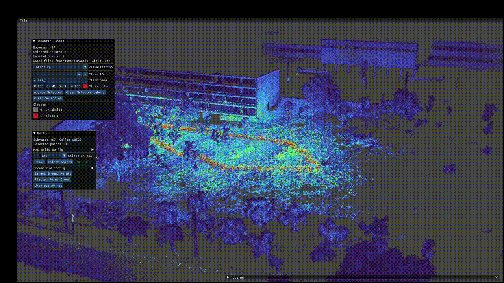

# GLIM Manual Segmentation Editor

Standalone ROS 2 package for manually assigning semantic class labels to points in a GLIM map.

This package links against GLIM, reuses the same viewer stack, and stores semantic annotations in a file so the original SLAM/map remains unchanged.

## Features

- Load a GLIM map directory containing `graph.txt` and submap folders.
- Load a standalone `.ply` or `.pcd` point cloud file as a single segmentable map.
- Select points with the GLIM editor tools:
  - gizmo box/sphere selection
  - radius selection
  - outlier radius selection
  - MinCut segmentation
  - RegionGrowing segmentation
  - Automatic ground selection based on [GroundGrid](https://github.com/dcmlr/groundgrid/tree/ros2-jazzy)
- Assign integer semantic class IDs to selected points.
- Edit class names and RGBA colors.
- Switch visualization between segmentation, intensity, Z height, and flat color.
- Save and reload labels from the loaded source's default label file.
- Export a binary PLY with a per-point signed 32-bit `class` property.

## Gallery




## Build

From the ROS 2 workspace root:

```bash
colcon build --packages-select glim_manual_segmentation_editor
source install/setup.bash
```

## Run

```bash
ros2 run glim_manual_segmentation_editor manual_segmentation_editor /path/to/glim_dump
ros2 run glim_manual_segmentation_editor manual_segmentation_editor /path/to/cloud.pcd
ros2 run glim_manual_segmentation_editor manual_segmentation_editor /path/to/cloud.ply
```

The input path argument is optional. If omitted, use `File > Open GLIM Map Directory` or `File > Open Point Cloud File` in the viewer.

Standalone clouds must contain scalar `x`, `y`, and `z` fields. Common intensity field names are retained, and existing `normal_x`/`normal_y`/`normal_z` or `nx`/`ny`/`nz` fields are used when valid. Otherwise, normals are estimated after loading. Non-finite points are skipped while keeping imported attributes aligned.

## Basic Workflow

1. Start the editor.
2. Load a GLIM map directory or a standalone PLY/PCD file.
3. Select points using the editor selection tools.
4. In `Semantic Labels`, choose a class ID, name, and color.
5. Click `Assign Selected`.
6. Use `File > Save Labels` to write the default semantic label file.
7. Use `File > Export Semantic PLY` to export the full map with semantic labels.

Class `0` is reserved for `unlabeled`. Clearing selected labels resets those points to class `0`.

## Visualization Modes

The `Semantic Labels` panel has a `Visualization` selector:

- `Segmentation`: colors points by semantic class.
- `Intensity`: colors points by intensity with a TURBO colormap. Submaps without intensity use gray fallback.
- `Z`: colors points by world-frame height.
- `Flat color`: renders all map points with one editable color.

Labels can still be edited in any visualization mode. Switching back to `Segmentation` reapplies the semantic colors.

## Label Storage

For GLIM map directories, labels are stored in:

```text
<map_path>/semantic_labels.json
```

For standalone point-cloud files, labels are stored beside the cloud:

```text
<cloud_path>.semantic_labels.json
```

The file contains:

- format version
- class metadata: ID, name, RGBA color
- submap IDs and point counts
- run-length encoded class labels aligned to each submap's point order

Loading validates submap count and per-submap point counts before applying labels.

## PLY Export

`File > Export Semantic PLY` exports all loaded map points in world coordinates.

The exported PLY includes:

- all map vertices
- intensity, when every loaded submap has intensities
- `property int class`

Unlabeled points are exported as class `0`.

## Citation

If you use this project please cite the relevant papers:
```
@article{koide2024glim,
  title={GLIM: 3D range-inertial localization and mapping with GPU-accelerated scan matching factors},
  author={Koide, Kenji and Yokozuka, Masashi and Oishi, Shuji and Banno, Atsuhiko},
  journal={Robotics and Autonomous Systems},
  volume={179},
  pages={104750},
  year={2024},
  publisher={Elsevier}
}
```


If you use the ground segmentation tool please cite:
```
@article{steinke2024groundgrid,
  author={Steinke, Nicolai and Goehring, Daniel and Rojas, Raúl},
  journal={IEEE Robotics and Automation Letters},
  title={GroundGrid: LiDAR Point Cloud Ground Segmentation and Terrain Estimation},
  year={2024},
  volume={9},
  number={1},
  pages={420-426},
  keywords={Sensors;Point cloud compression;Estimation;Laser radar;Image segmentation;Task analysis;Robot sensing systems;Range Sensing;Mapping;Field Robots},
  doi={10.1109/LRA.2023.3333233}
}
```
